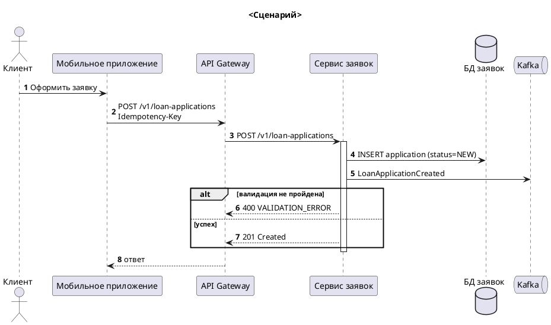
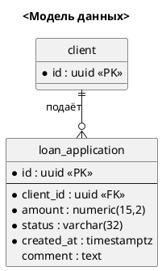
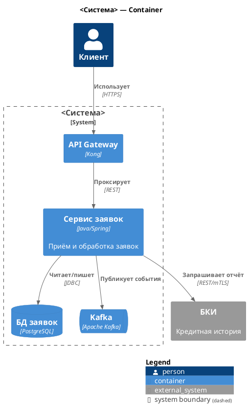
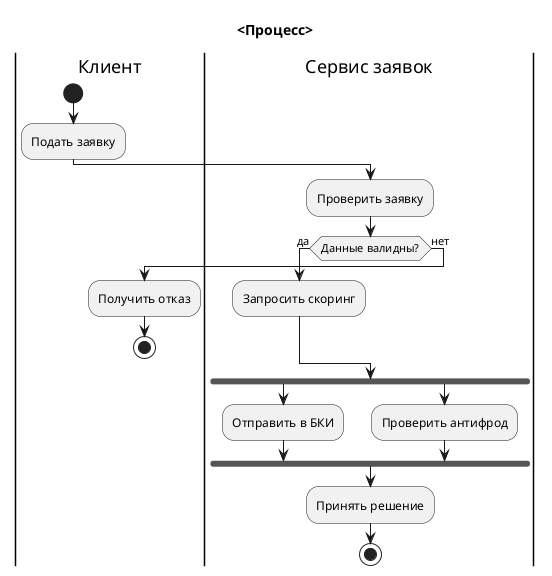
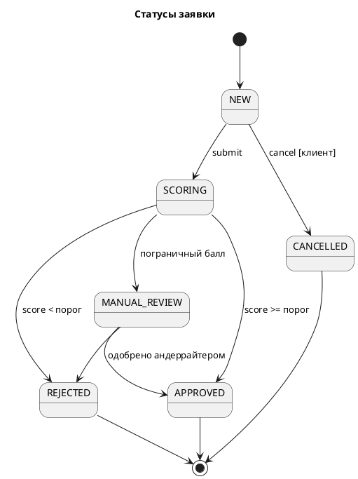

# Генерация диаграмм (PlantUML)

**Вход:** текстовое описание потока / сценария / структуры.
**Выход:** `outputs/diagrams/<project_id>_<объект>_<тип>_v<N>.puml` + текстовое описание в
сообщении (и в документе, если диаграмма встраивается). Малый артефакт — сразу результат.

## Выбор типа (если не указан)

| Во входе | Тип |
|---|---|
| Кто кого вызывает, в каком порядке, запрос/ответ | **sequence** |
| Сущности, атрибуты, связи, таблицы | **ERD** |
| Какие системы/сервисы есть и как связаны (без порядка во времени) | **C4** (Context — системы и люди; Container — сервисы, БД, брокеры; Component — внутри сервиса) |
| Шаги процесса, ветвления, роли (дорожки), бизнес-поток | **activity** со swimlanes |
| Статусы объекта и переходы между ними | **state** |

Назови выбранный тип одной строкой. Если сомнение между двумя — выбери и предложи второй.

## Правила для всех

- Участники / сущности — латинские alias, подписи — на языке артефакта:
  `participant "Сервис заявок" as LoanSvc`
- Имена компонентов — **как в `project_context.md`**, без синонимов.
- Не больше ~15 участников / ~25 сущностей на одной диаграмме — иначе предложи разбить.
- `title` обязателен. Нумерация шагов в sequence — `autonumber`.
- Не рисуй то, чего нет во входе. Предполагаемый шаг → `note` с «⚠️ Допущение».
- Проверь синтаксис: парные `alt/end`, `group/end`, `if/endif`, закрытые `{}`, `@startuml/@enduml`.

## Шаблоны

### Sequence

Используй `alt/else`, `opt`, `loop`, `par`, `group "Retry x3"`, `...таймаут 30 с...`,
`note right`. Асинхронное сообщение — `->>`. Ответ — `-->`.

### ERD

`*` — NOT NULL. Кардинальности: `||--||`, `||--o{`, `}o--o{`.

### C4 (Container)

Context: `!include <C4/C4_Context>`, `Person`, `System`, `System_Ext`.
Component: `!include <C4/C4_Component>`, `Component(...)` внутри `Container_Boundary`.

### Activity (процесс со swimlanes)

### State

Переходы подписывать `событие [условие] / действие`. Вместе с state-диаграммой
всегда выдавай таблицу переходов (из статуса | событие | в статус | условие | побочные эффекты)
и отмечай недостижимые / тупиковые статусы, если есть.

## Текстовое описание (в сообщении)

- Что изображено (1–2 предложения)
- Ключевые решения/особенности, видные на диаграмме (асинхронность, точки отказа, retry)
- Допущения
- Как посмотреть: плагин PlantUML в IDE (локальный рендер) или макрос PlantUML в Confluence

Не предлагай публичный сервер plantuml.com и онлайн-редакторы: код диаграммы уходит на
чужой сервер, а в нём — архитектура и данные работодателя. Если аналитик сам просит
ссылку на онлайн-рендер — напомни об этом одной строкой.

## Конвертация между типами

«Переделай sequence в activity» и т.п. — сохрани смысл, покажи, что потерялось
при конвертации (например, activity не показывает, кто кого вызывает синхронно).
Результат — новый файл с другим типом в имени.
